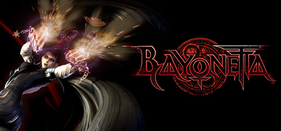

**Bayonetta is the definitive stylish action game where an amnesiac witch battles angels using Witch Time dodge counters, hair-summoned demons, and elaborate combo chains. Every encounter rewards mastery with Pure Platinum rankings in this technical action masterpiece.**

---

## 📖 About

Bayonetta is the definitive stylish action game where an amnesiac witch battles angels using Witch Time dodge counters, hair-summoned demons, and elaborate combo chains. Every encounter rewards mastery with Pure Platinum rankings in this technical action masterpiece.

## ⚠️ Problems Without Trainer

| Problem | Status |
|---------|--------|
| **Pure Platinum Grind** — Getting top ranks on every chapter requires near-perfect play | ✅ Solved |
| **Witch Time Dependency** — Missing dodge counters dramatically increases difficulty | ✅ Solved |
| **Combo Complexity** — Deep weapon and stance system has a steep mastery curve | ✅ Solved |
| **Quick Time Events** — Missed QTEs during boss fights cause instant death | ✅ Solved |

## ✅ Solution

The **Bayonetta Trainer** solves all these issues by giving you complete control over the game.

## 🎯 Full Feature List

- Unlimited Resources
- God Mode / Invincibility
- Instant Skill Cooldown
- One-Hit Kill
- Freeze Game Timer
- Unlock All Items & Achievements
- Custom Speed Multiplier
- Save State Anywhere

## 🚀 Quick Start

1. **Disable Windows Defender** temporarily (trainer may trigger false positive)
2. Download the trainer from the button above
3. Launch Bayonetta
4. Run the trainer as Administrator
5. Activate desired cheats with hotkeys

## 💎 Free vs Paid

| Feature | Free | Pro |
|---------|------|-----|
| Basic God Mode | ✅ | ✅ |
| Unlimited Resources | ✅ | ✅ |
| All Advanced Cheats | ❌ | ✅ |
| Auto-Updates | ❌ | ✅ |
| Priority Support | ❌ | ✅ |

## 💻 Requirements

- Windows 10/11 (64-bit)
- Bayonetta (any version)
- .NET Framework 4.8+
- DirectX 11+

## 🍎 macOS

macOS users can use our alternative tool:

## ⚖️ Legal

This trainer is for educational and single-player use only. Use responsibly.

---

